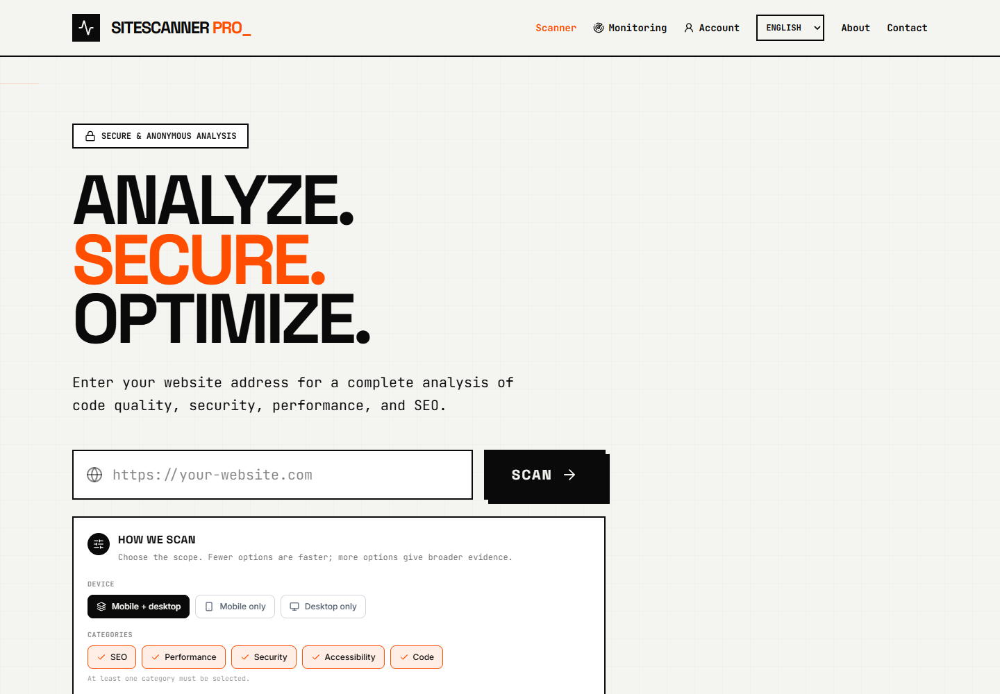
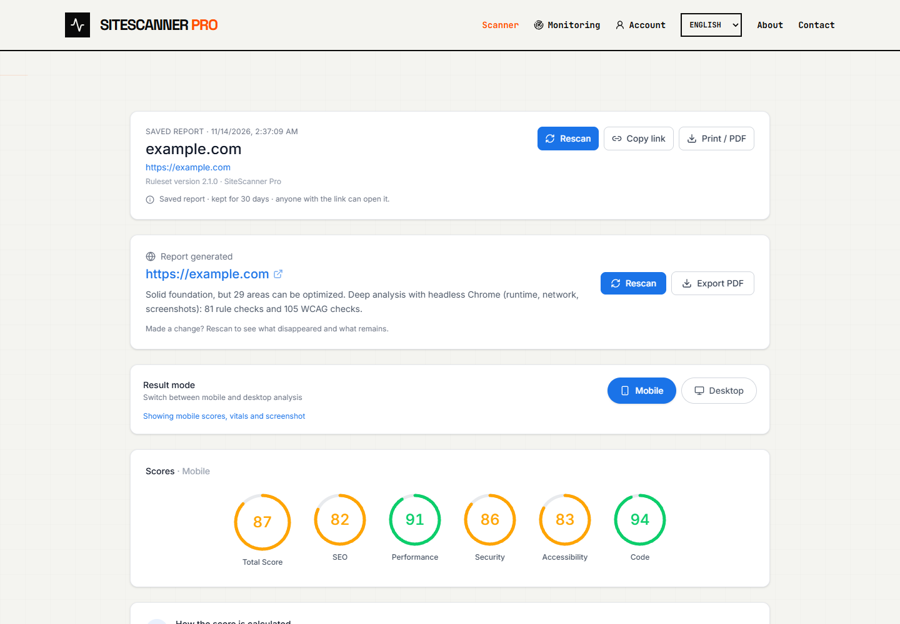
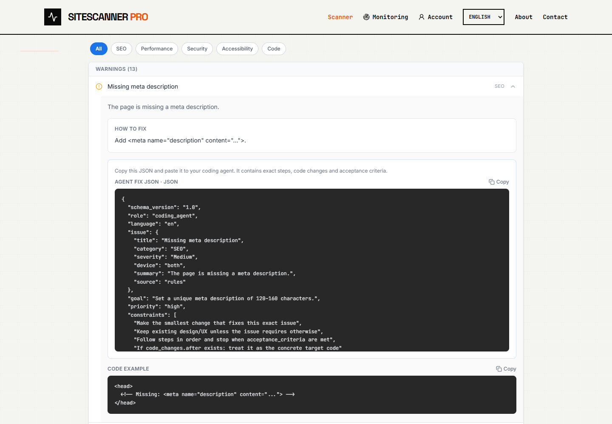
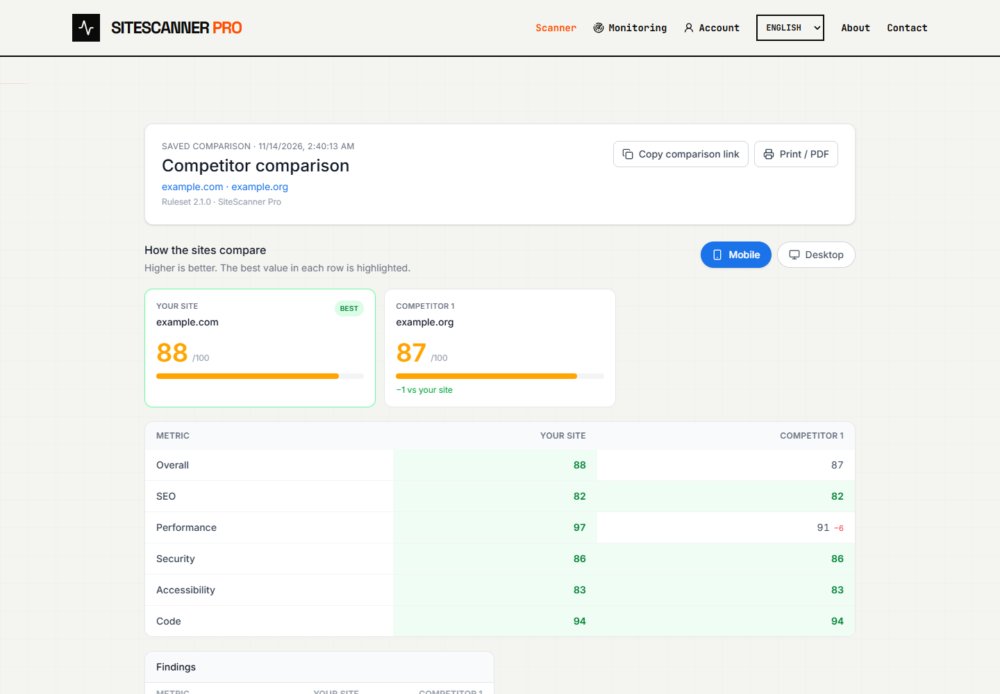
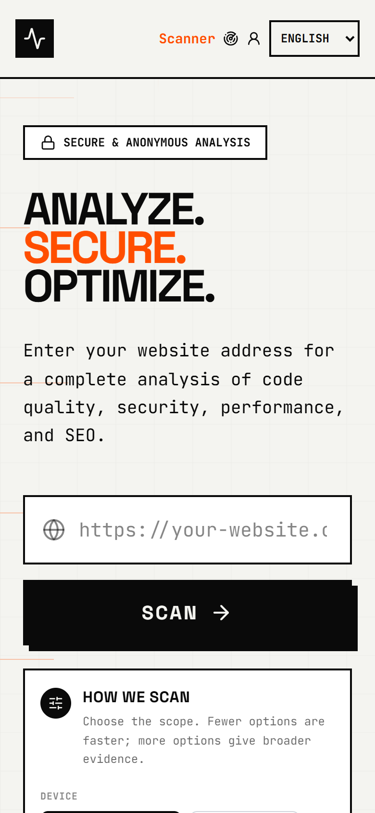
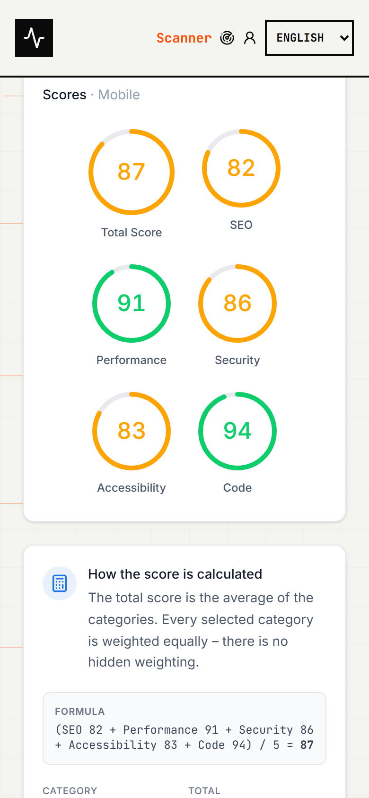
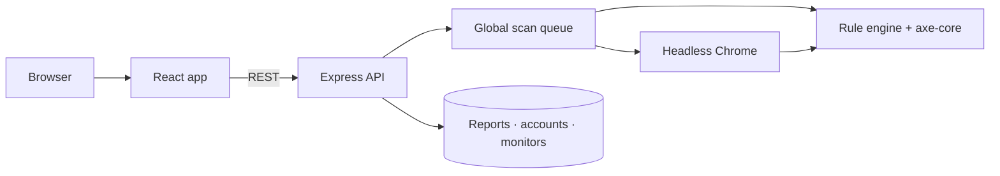

<div align="center">

<a href="https://nrnworld.one/SiteScannerPro/">
  
</a>

<br />
<br />

# SiteScanner Pro

**See what is holding your website back.**

SiteScanner Pro turns any public URL into a clear, prioritized website health report — covering SEO, performance, security, accessibility and code quality.

[](https://nrnworld.one/SiteScannerPro/)
[](LICENSE)
[](https://github.com/nRn-World/SiteScannerPro/actions/workflows/deploy-pages.yml)


</div>

---

## Why SiteScanner Pro

Most website checkers stop at a score. SiteScanner Pro shows you **what is wrong, why it matters and exactly how to fix it**.

<table>
  <tr>
    <td width="33%" valign="top">
      <h3>One scan. Five dimensions.</h3>
      <p>SEO, performance, security, accessibility and code quality analyzed together in a single report.</p>
    </td>
    <td width="33%" valign="top">
      <h3>Evidence, not guesses.</h3>
      <p>Real browser measurements, runtime and network signals, screenshots and WCAG checks back every finding.</p>
    </td>
    <td width="33%" valign="top">
      <h3>Built for action.</h3>
      <p>Every issue includes a prioritized recommendation, a ready-to-use code fix and an agent-ready JSON task.</p>
    </td>
  </tr>
</table>

## A report you can act on

<p align="center">
  
</p>

<p align="center"><em>One overall score, five category scores and a prioritized action plan — with mobile and desktop result modes.</em></p>

## From finding to fix

<p align="center">
  
</p>

<p align="center"><em>Expand any finding to see the explanation, the exact fix, a copy-ready code example and a structured agent task.</em></p>

## Compare with confidence

<p align="center">
  
</p>

<p align="center"><em>Compare up to two competitors with the same ruleset and device — and see where the real gaps are.</em></p>

## Responsive by design

<p align="center">
  
  &nbsp;&nbsp;
  
</p>

<p align="center"><em>Scan, review scores and act on findings from a phone — the same complete workflow, adapted to a smaller screen.</em></p>

## Everything included

| Capability | What you get |
|---|---|
| **Deep website scan** | Headless Chrome analysis, deterministic rules and axe-core WCAG audits |
| **Prioritized findings** | Severity, category, explanation, evidence and a recommended fix |
| **Code solutions** | Ready-to-use HTML, CSS, JavaScript and HTTP-header snippets |
| **Agent fix JSON** | Structured tasks with steps, code changes, constraints and acceptance criteria |
| **Screenshots** | Full-page captures and issue-level visual evidence |
| **Competitor comparison** | Benchmark up to two sites on the same device and ruleset |
| **Saved reports** | Shareable report links, PDF export and a 30-day report window |
| **Accounts & monitoring** | Optional accounts, saved sites, scheduled checks and score alerts |
| **Six languages** | English, Svenska, Türkçe, Español, Français and العربية |

> **Free by design.** There is no paywall, checkout, subscription or locked result. Every scan returns the complete report.

## How it works

1. **Enter a public URL** and choose the device scope and categories you care about.
2. **The engine gets to work** — headless Chrome loads the page while deterministic rules and WCAG checks evaluate the evidence.
3. **Get a clear report** with scores, prioritized findings and the exact changes that will improve them.
4. **Fix, rescan and compare** to verify the impact of every change.

## Tech stack

| Layer | Tools |
|---|---|
| **Interface** | React 19, TypeScript, Vite 6, Tailwind CSS v4, Motion, Lucide |
| **Analysis** | Puppeteer, Cheerio, JSDOM, axe-core |
| **Server** | Node.js, Express, Nodemailer |
| **Delivery** | GitHub Pages for the frontend, Render for the API |
| **Testing** | Node.js test runner, TypeScript, deterministic regression tests |

## Architecture



- The frontend is a static Vite build that can be hosted on GitHub Pages.
- The Express API owns scanning, saved reports, accounts, monitoring and share-link signing.
- Scans run through a bounded queue so concurrent browser work cannot overwhelm the host.
- The same ruleset and device scope are used for both sides of a competitor comparison.

## Running locally

**Prerequisites:** Node.js 20+ and npm.

```bash
# 1. Clone the repository
git clone https://github.com/nRn-World/SiteScannerPro.git
cd SiteScannerPro

# 2. Install dependencies
npm install

# 3. Create your environment file
cp .env.example .env

# 4. Start the frontend and API on one port
npm run dev
```

Open **http://localhost:3000**. Set `PORT` in `.env` to use a different port.

### Environment variables

| Variable | Purpose |
|---|---|
| `LICENSE_SIGNING_SECRET` | Signs share links. Use at least 32 random characters. |
| `APP_URL` | Public URL of the app, used for canonical links and share URLs. |
| `PORT` | Server port. Defaults to `3000`. |
| `DATA_DIR` | Persistent directory for reports, accounts and monitors. |
| `LOG_LEVEL` | `debug`, `info`, `warn` or `error`. |
| `MAX_CONCURRENT_SCANS` | Maximum queued scan concurrency. |
| `MAX_CONCURRENT_PAGES` | Maximum simultaneous Puppeteer pages. |
| `REPORT_SHARE_TTL_DAYS` | Lifetime of shared report links in days. |
| `EMAIL_USER` / `EMAIL_PASS` | Optional Gmail credentials for the contact form. |
| `CONTACT_RECEIVER_EMAIL` | Optional recipient for contact-form messages. |

### Useful scripts

| Command | Description |
|---|---|
| `npm run dev` | Start the Vite middleware and Express API together |
| `npm run build` | Build the frontend and prerender static SEO metadata |
| `npm start` | Serve the production build |
| `npm run lint` | Type-check the project |
| `npm test` | Run the full unit and regression test suite |

## Deployment

Pushes to `main` deploy automatically:

- **Frontend** → GitHub Pages via [`.github/workflows/deploy-pages.yml`](.github/workflows/deploy-pages.yml)
- **Backend** → Render via [`render.yaml`](render.yaml)

Production environment variables: `APP_URL`, `CORS_ORIGIN`, `DATA_DIR`, `LICENSE_SIGNING_SECRET`, `LOG_LEVEL`, `MAX_CONCURRENT_SCANS`, `MAX_CONCURRENT_PAGES` and `REPORT_SHARE_TTL_DAYS`.

## Security & reliability

- Per-IP rate limits on scan, contact and account endpoints, with `429` and `Retry-After`.
- A global scan queue with bounded Puppeteer concurrency.
- SSRF protection validates resolved addresses against private and link-local ranges before fetching.
- CORS has no wildcard fallback: unknown origins receive no `Access-Control-Allow-Origin` header.
- Share links are signed server-side; no personal data is embedded in a share token.
- Structured logging with per-scan correlation IDs; full scan URLs are never logged, only the host.
- Browser analysis fetches fresh pages rather than reusing the shared browser cache.

## Important information

SiteScanner Pro provides automated analysis and recommendations. Results are a starting point and should be reviewed by a qualified developer before production changes are made. A scan cannot replace a complete security, accessibility, legal or performance audit.

## License

SiteScanner Pro is released under the **Creative Commons Attribution-NonCommercial 4.0 International Public License (CC BY-NC 4.0)**.

You may share and adapt the project for non-commercial purposes with attribution. Commercial use requires separate written permission from the copyright holder. See [LICENSE](LICENSE) for the complete official English license text.

## Contact

For support, feedback and business enquiries: **bynrnworld@gmail.com**

---

<p align="center">
  Created with care by <strong>nRn World</strong> · © 2026
</p>
